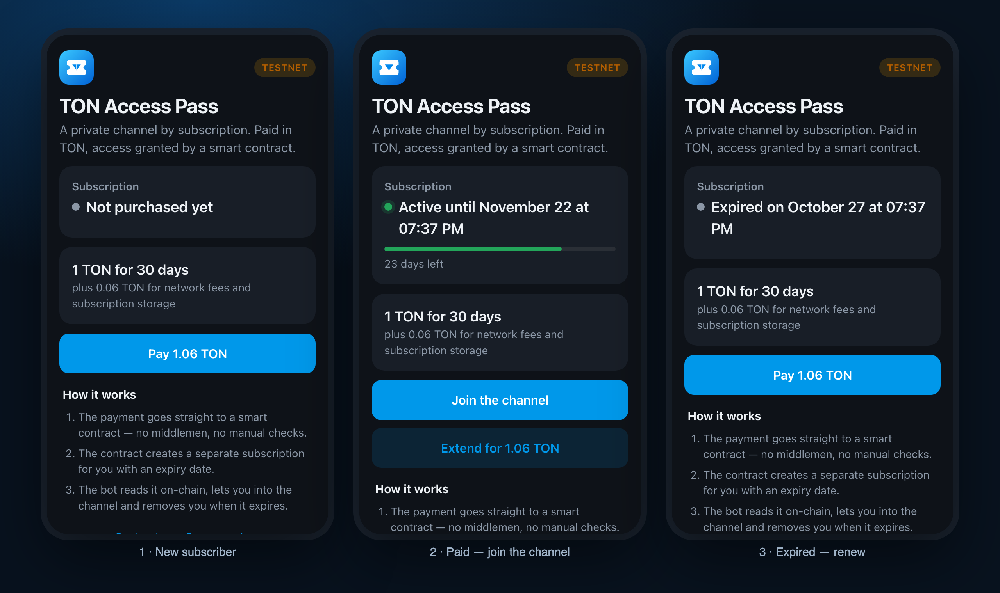
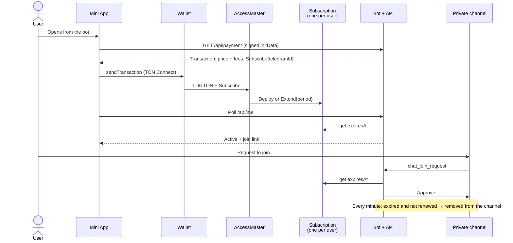

<div align="center">


# TON Access Pass

**Paid access to a private Telegram channel — paid in TON, enforced by a smart contract.**

A Telegram Mini App, a Tact smart contract and a bot that lets subscribers in and removes them when the subscription expires.
The source of truth is the blockchain: anyone can verify a subscription without trusting the backend.

[](https://testnet.tonviewer.com/kQAcI3X5Pt46n3grbyZBW5QegZDhjkfd2wVTb1s8PupuSg1m)
[](https://tact-lang.org)
[](https://core.telegram.org/bots/webapps)
[](#tests)
[](LICENSE)

[Live Mini App](https://pass.itssteps.site) · [Contract on Tonviewer](https://testnet.tonviewer.com/kQAcI3X5Pt46n3grbyZBW5QegZDhjkfd2wVTb1s8PupuSg1m) · [Русская версия](README.ru.md)



</div>

## What it does

1. A user opens the Mini App from the bot and sees the price: **1 TON for 30 days**.
2. They connect a wallet with **TON Connect** and pay. The payment goes straight to the smart contract.
3. The contract creates a personal `Subscription` contract with an expiry date (or extends the existing one).
4. The bot sees the subscription on-chain and approves the request to join the private channel.
5. When the subscription expires and is not renewed, the bot removes the user from the channel and offers to renew.

No manual checks, no payment provider, no database of "who paid" that you have to trust.

## How it works



## Design decisions

- **One contract per subscriber**, not a shared map. In TON, storage and gas grow with contract state; a small contract per user is the standard scaling pattern (the same idea as jetton wallets). The address is derived from `(master, telegramId)`, so the backend computes it locally without any index.
- **The blockchain is the source of truth.** The bot keeps only a cache of who is in the channel. Every decision — approve a join request, keep or remove a member — is made by reading `expiresAt` on-chain.
- **Join requests instead of invite links.** The channel link is public but useless without a subscription: every request is checked by the bot. A leaked link gives nothing.
- **Telegram identity is verified.** The API trusts only `initData` signed by Telegram (HMAC with the bot token), so you cannot read or pay "as" someone else from the Mini App.
- **Early renewal adds time, it does not reset it.** Extension counts from `max(now, expiresAt)`.
- **Failure-tolerant.** If the TON API is down, a join request is not rejected — it stays pending and is re-checked on the next sweep.
- **Found on real testnet:** some wallets take the forwarding fee out of the amount, so the contract received 1.04993 TON instead of 1.05 and (correctly) bounced the payment. The backend now asks for a 0.01 TON reserve, with a regression test for it.

## Smart contracts

Written in [Tact](https://tact-lang.org), source: [`contracts/access_pass.tact`](contracts/access_pass.tact).

### `AccessMaster` — one per channel

| Message | Who | What it does |
|---|---|---|
| `Subscribe { queryId, telegramId }` | anyone | Pays for a period. Requires `price + 0.05 TON`; 0.05 deploys and funds the `Subscription`. Less → rejected and bounced back. |
| `Withdraw { amount }` | owner | Withdraws revenue, always keeping 0.1 TON for storage. |
| `SetPrice { price }` | owner | Changes the price for new payments. |

Getters: `price`, `period`, `sales`, `owner`, `subscriptionAddress(telegramId)`.

### `Subscription` — one per Telegram user

| Message | Who | What it does |
|---|---|---|
| `Extend { queryId, period, payer }` | only its `AccessMaster` | `expiresAt = max(now, expiresAt) + period` |

Getters: `expiresAt`, `isActive`, `telegramId`.

Network fees for one payment (master + subscription deploy): **≈ 0.001 TON**.

## Project structure

```
contracts/      Tact smart contracts
tests/          Sandbox tests for contracts and backend
backend/        Bot + HTTP API (Node.js, no framework), bundled into one file
  chain.ts        reads subscriptions on-chain, builds TON Connect transactions
  service.ts      join requests, expiry sweep, bot commands
  api.ts          /api/config, /api/me, /api/payment
  telegram.ts     initData verification, Bot API client
app/            Mini App (Vite + TypeScript, no framework, Telegram theme colors)
scripts/        testnet wallet, contract deploy, test payment, server deploy
server/         systemd unit and a setup script for the bot token
docs/SPEC.md    one-page specification
```

## Run it yourself

Requirements: Node.js 22+.

```bash
npm install
npm test                 # compiles contracts and runs 25 tests
npm run app:dev          # Mini App with mock data: /?mock=new | active | expired
```

### Deploy to testnet

```bash
npx ts-node scripts/dev-wallet.ts          # creates a local testnet wallet, prints its address
# top it up with test TON: @testgiver_ton_bot in Telegram
npx ts-node scripts/deploy-testnet.ts 1 30  # 1 TON for 30 days → prints MASTER_ADDRESS
npx ts-node scripts/pay-testnet.ts <MASTER_ADDRESS> <telegramId>   # a test payment without the Mini App
```

The wallet mnemonic is stored in `.wallet.testnet.json` (mode 600, git-ignored) and is never printed.

### Backend configuration

| Variable | Required | Description |
|---|---|---|
| `BOT_TOKEN` | yes | Token from @BotFather |
| `MASTER_ADDRESS` | yes | Deployed `AccessMaster` address |
| `TON_NETWORK` | | `testnet` (default) or `mainnet` |
| `MINI_APP_URL` | | Mini App URL for bot buttons and the menu button |
| `CHANNEL_ID` | | Private channel ID. If empty, the bot remembers the channel it is made admin of |
| `TONCENTER_API_KEY` | | Raises the toncenter rate limit (1 rps without a key) |
| `PORT`, `DATA_FILE` | | `8096`, `./data/state.json` |

On a server the backend runs as a hardened systemd service ([`server/ton-access-pass.service`](server/ton-access-pass.service)) behind Caddy. The bot token is entered once with a hidden prompt (`ton-access-pass-setup`) and never stored in the repository.

## Tests

`npm test` — 25 tests on [@ton/sandbox](https://github.com/ton-org/sandbox):

- **Contract:** subscription deploy, early renewal, renewal after expiry, separate subscriptions per user, underpayment bounces, only the master can extend, owner-only withdraw with storage reserve, owner-only price change, network fee budget.
- **Backend on the sandbox chain:** the transaction built for TON Connect is accepted by the contract; it still works when the wallet takes the fee out of the amount.
- **Bot logic:** approve/decline join requests, pending requests while the chain is down, removal after expiry but not after early renewal, channel auto-detection.
- **API:** Telegram signature checks (forged user, another bot, stale data), status and payment endpoints.

## Status

Running on **TON testnet** as a demo. Accepting cryptocurrency as payment on mainnet depends on the seller's jurisdiction — check local law before going live.

## Author

Built by **Stepan** — I build Telegram bots, Mini Apps, AI agents and web services for businesses.

[itssteps.site](https://itssteps.site) · Telegram [@SStepCEO](https://t.me/SStepCEO)

Released under the [MIT License](LICENSE).
