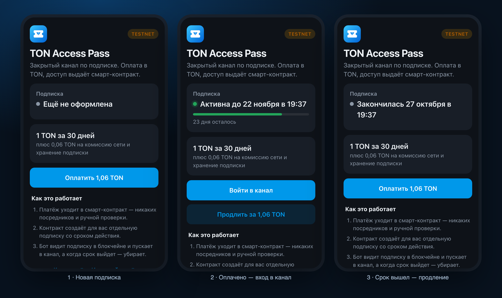

<div align="center">


# TON Access Pass

**Платный доступ в закрытый Telegram-канал: оплата в TON, доступ выдаёт смарт-контракт.**

Telegram Mini App, смарт-контракт на Tact и бот, который пускает подписчиков в канал и убирает их, когда подписка закончилась.
Источник правды — блокчейн: подписку может проверить кто угодно, не доверяя бэкенду.

[Mini App](https://pass.itssteps.site) · [Контракт в Tonviewer](https://testnet.tonviewer.com/kQAcI3X5Pt46n3grbyZBW5QegZDhjkfd2wVTb1s8PupuSg1m) · [English](README.md)



</div>

## Что умеет

1. Пользователь открывает Mini App из бота и видит цену: **1 TON за 30 дней**.
2. Подключает кошелёк через **TON Connect** и платит — деньги уходят прямо в смарт-контракт.
3. Контракт создаёт для пользователя личный контракт `Subscription` со сроком действия или продлевает его.
4. Бот видит подписку в блокчейне и одобряет заявку на вступление в закрытый канал.
5. Когда срок вышел, а продления нет, бот убирает пользователя из канала и предлагает продлить.

Никакой ручной проверки, платёжного агрегатора и базы «кто заплатил», которой нужно верить на слово.

## Как устроено

- **Отдельный контракт на каждого подписчика**, а не общий словарь: в TON хранение и газ растут с размером состояния, поэтому маленький контракт на пользователя — стандартный способ масштабирования (как jetton-кошельки). Адрес вычисляется из `(мастер, telegramId)`, бэкенду не нужен индекс.
- **Блокчейн — источник правды.** Бот хранит только кэш участников канала, а каждое решение — пустить, оставить, убрать — принимает по `expiresAt` из контракта.
- **Заявки на вступление вместо одноразовых ссылок.** Ссылка на канал бесполезна без подписки: каждую заявку проверяет бот.
- **Личность из Telegram проверяется.** API принимает только `initData`, подписанные Telegram (HMAC от токена бота), — оплатить или посмотреть статус «от чужого имени» нельзя.
- **Продление заранее не сгорает:** срок считается от `max(сейчас, expiresAt)`.
- **Устойчивость к сбоям.** Если сеть TON не ответила, заявка не отклоняется, а ждёт следующей проверки.
- **Найдено в настоящем testnet:** некоторые кошельки вычитают комиссию пересылки из суммы — до контракта дошло 1,04993 TON вместо 1,05, и он (правильно) вернул платёж. Теперь бэкенд просит запас 0,01 TON, на это есть регрессионный тест.

Подробнее о контрактах, структуре проекта, запуске и тестах — в [английском README](README.md) и [спецификации](docs/SPEC.md).

## Быстрый старт

```bash
npm install
npm test                 # компиляция контрактов и 25 тестов
npm run app:dev          # Mini App на тестовых данных: /?mock=new | active | expired
```

## Статус

Работает в **TON testnet** как демо. Приём криптовалюты в оплату в mainnet зависит от законодательства страны продавца — перед запуском это нужно проверить.

## Автор

**Степан** — делаю Telegram-ботов, Mini Apps, ИИ-агентов и веб-сервисы для бизнеса.

[itssteps.site](https://itssteps.site) · Telegram [@SStepCEO](https://t.me/SStepCEO)

Лицензия [MIT](LICENSE).
